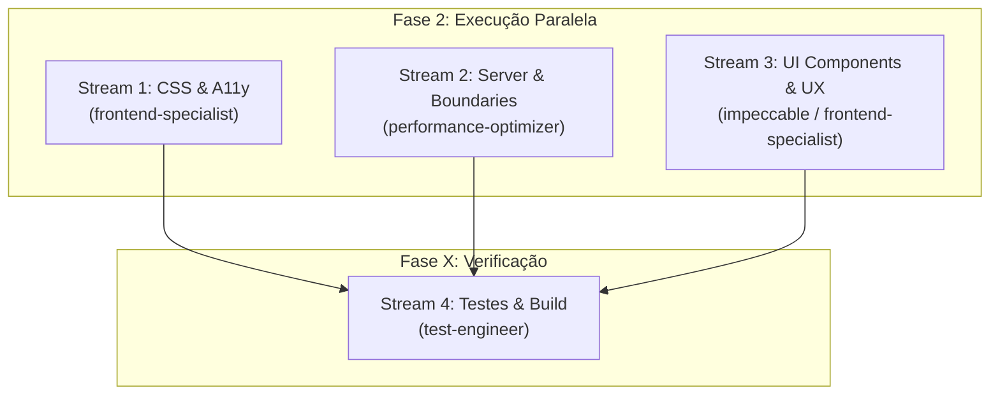

# Plano de Execução: Melhorias do Front-end (Hub Local)

> **Documento:** `frontend-improvements.md`  
> **Status:** Proposto para aprovação (Fase 1: Planejamento)  
> **Tipo de Projeto:** WEB (Next.js 16 App Router + React 19 + Tailwind CSS v4)  
> **Coordenação:** Multi-Agent Orchestration (`orchestrator`, `frontend-specialist`, `performance-optimizer`, `test-engineer`)

---

## 1. Visão Geral (Overview)

Este plano operacionaliza a execução simultânea e coordenada das melhorias diagnosticadas na auditoria técnica de front-end do **Hub Local** (`dashboard-localhost`). O objetivo é elevar o craft, a acessibilidade (WCAG AA), a ergonomia para desenvolvedores e o desempenho de renderização, sem introduzir dependências externas pesadas ou quebrar os contratos existentes do SQLite.

---

## 2. Critérios de Sucesso (Success Criteria)

- [x] **Acessibilidade:** Remoção completa do anti-pattern de 0.01ms no `prefers-reduced-motion` em `globals.css`.
- [x] **Contraste WCAG AA:** Relação de contraste mínima de 4.5:1 em todos os micro-textos (<12px).
- [x] **Tipografia:** Fontes "Inter" e "JetBrains Mono" provisionadas sem FOUT via `next/font/google` no `layout.tsx`.
- [x] **Resiliência de Rotas:** Telas de `error.tsx` e `loading.tsx` adicionadas ao App Router.
- [x] **Performance SSR:** `loadInventory()` encapsulado em `React.cache()` eliminando chamadas duplicadas no mesmo ciclo de render.
- [x] **Correção de Workspace:** Pacotes em execução em monorepos mantêm sua raiz de workspace visível no filtro `running`.
- [x] **Interação Modal & Tooltip:** `<dialog>` fecha ao clicar no backdrop e tooltips eliminam colisão com o `title` nativo.
- [x] **Ergonomia Dev:** Atalho de teclado `/` foca a busca no inventário com suporte a `Escape` e badge `<kbd>/</kbd>`.
- [x] **Zero Regressões:** `typecheck`, `lint`, `test` e `build` 100% aprovados.

---

## 3. Divisão de Trabalho por Subagentes (Workstreams Paralelos)

A implementação será executada em **3 streams de código paralelos** seguidos por **1 stream de verificação final**:



---

### Stream 1: CSS, Tipografia & Acessibilidade de Tokens
* **Agente Designado:** `frontend-specialist` (Persona UI/UX & CSS)
* **Arquivos Alvo:**
  - `src/app/globals.css`
  - `src/app/layout.tsx`
* **Tarefas:**
  1. **Ajustar `prefers-reduced-motion`:**
     - Substituir o seletor `animation-duration: 0.01ms !important; transition-duration: 0.01ms !important;` por uma alternativa limpa:
       ```css
       @media (prefers-reduced-motion: reduce) {
         *, *::before, *::after {
           animation-duration: 1ms !important;
           transition-duration: 1ms !important;
           animation-iteration-count: 1 !important;
           scroll-behavior: auto !important;
         }
       }
       ```
  2. **Fontes com `next/font/google`:**
     - Importar `Inter` e `JetBrains_Mono` no `layout.tsx`, configurando as variáveis CSS `--font-sans` e `--font-mono` no elemento `<html>`.
  3. **Ajuste de Contraste:**
     - Ajustar tokens em `globals.css` ou elevar opacidade de `text-hub-text-muted/70` para garantir legibilidade imediata em textos de porta, branch e caminho.

---

### Stream 2: Next.js Architecture, Server Cache & Error Boundaries
* **Agente Designado:** `performance-optimizer` / `backend-specialist`
* **Arquivos Alvo:**
  - `src/lib/server/overview.ts`
  - `src/app/error.tsx` (novo)
  - `src/app/loading.tsx` (novo)
* **Tarefas:**
  1. **Deduplicação de Request com `React.cache()`:**
     - Envolver a exportação de `loadInventory` em `src/lib/server/overview.ts` com `cache()` do React para evitar que o layout e a página executem duas consultas completas ao SQLite por requisição.
  2. **Criar `src/app/error.tsx`:**
     - Error boundary cliente com botão de "Tentar novamente" (`reset()`) estilizado na paleta de status do hub.
  3. **Criar `src/app/loading.tsx`:**
     - Streaming fallback renderizando `<ProjectGridSkeleton count={6} />` para transições visuais instantâneas.

---

### Stream 3: Componentes UI, Interação & Usabilidade
* **Agente Designado:** `frontend-specialist` (Persona Craft & Impeccable)
* **Arquivos Alvo:**
  - `src/components/ui/dialog.tsx`
  - `src/components/ui/tooltip.tsx`
  - `src/components/project-browser.tsx`
* **Tarefas:**
  1. **Backdrop Click no `<dialog>`:**
     - Adicionar manipulador de clique no elemento dialog que fecha a janela quando o clique ocorre fora de sua caixa delimitadora (`rect`).
  2. **Saneamento do Tooltip:**
     - Remover o atributo duplicado `title={label}` do span contenedor quando o tooltip flutuante estiver ativo para evitar o "double tooltip" nativo do navegador.
  3. **Correção de Filtro de Workspaces:**
     - Em `project-browser.tsx`, assegurar que um workspace pai seja mantido na visualização quando qualquer um de seus pacotes filhos atender ao filtro selecionado (`filter === 'running'`).
  4. **Atalho de Teclado `/` para Busca:**
     - Adicionar listener global para a tecla `/` que posiciona o foco no campo de busca (`#project-search`), ignorando quando o foco já estiver em outro input. Adicionar indicador `<kbd>/</kbd>`.

---

### Stream 4: Verificação Técnica & Quality Gate (Fase X)
* **Agente Designado:** `test-engineer`
* **Verificações Obrigatórias:**
  1. `npm run typecheck`
  2. `npm run lint`
  3. `npm test`
  4. `npm run build`
  5. Inspeção de integridade com `impeccable detect`

---

## 4. Estrutura de Arquivos Impactados

```
src/
├── app/
│   ├── error.tsx           <-- [NOVO] Error Boundary
│   ├── loading.tsx         <-- [NOVO] Streaming loading state
│   ├── globals.css         <-- [MODIFICADO] Reduced motion e tokens de contraste
│   └── layout.tsx          <-- [MODIFICADO] Inclusão de next/font/google
├── components/
│   ├── project-browser.tsx <-- [MODIFICADO] Atalho '/' e correção do filtro
│   └── ui/
│       ├── dialog.tsx      <-- [MODIFICADO] Backdrop click
│       └── tooltip.tsx     <-- [MODIFICADO] Remoção de title nativo conflitante
└── lib/
    └── server/
        └── overview.ts     <-- [MODIFICADO] Deduplicação com React.cache()
```

---

## 5. Rollback & Estratégia de Mitigação

- Se alguma fonte do Google apresentar lentidão ou falha de rede em ambiente offline, o fallback automático para fontes nativas do sistema (`system-ui`, `ui-monospace`) já está definido no `@theme`.
- Modificações em componentes são puramente aditivas e preservam todas as props e contratos existentes.
